# Product Enricher — Architecture & Implementation

This document describes how Product Enricher is built: its components, the lifecycle of a source
from upload to BigCommerce write, the data model, the AI calls, and the operational constraints.
For setup, see the [README](../README.md).

- [1. Overview](#1-overview)
- [2. Tech stack](#2-tech-stack)
- [3. System architecture](#3-system-architecture)
- [4. Source lifecycle](#4-source-lifecycle)
- [5. Analysis pipelines](#5-analysis-pipelines)
- [6. AI calls](#6-ai-calls)
- [7. Catalog matching](#7-catalog-matching)
- [8. Field routing and diffing](#8-field-routing-and-diffing)
- [9. Applying to BigCommerce](#9-applying-to-bigcommerce)
- [10. Data model](#10-data-model)
- [11. API reference](#11-api-reference)
- [12. Frontend](#12-frontend)
- [13. Storage and retention](#13-storage-and-retention)
- [14. Configuration](#14-configuration)
- [Channel ingest](#channel-ingest)
- [Deployment](#deployment)
- [15. Fixtures and scripts](#15-fixtures-and-scripts)
- [16. Source map](#16-source-map)
- [17. Known limitations](#17-known-limitations)
- [18. Verification record](#18-verification-record)

---

## 1. Overview

Product Enricher turns unstructured supplier material — spec sheets, price lists, emails,
packshots, photographed or handwritten notes — into reviewable catalog changes for a single
BigCommerce channel.

Design principles:

1. **Human in the loop.** The analyzer only *proposes*. Every write to BigCommerce happens from an
   explicit **Apply** on one action in the review modal.
2. **Only report what the source says.** The extraction prompt forbids invented values, and every
   proposed field carries the source sentence it came from (`evidence`), shown next to the value.
3. **Only surface new information.** Values that already match the catalog are dropped before the
   action is queued.
4. **Same code locally and deployed.** The database and file storage switch between local and
   managed backends by environment variables, not code paths.
5. **Keep files only as long as needed.** Documents never touch storage; images are deleted as soon
   as they stop being the payload of a pending action.

## 2. Tech stack

| Concern | Choice |
| --- | --- |
| Framework | Next.js 16 (App Router), React 19, TypeScript |
| Styling | Tailwind CSS 4 |
| AI | Vercel AI SDK (`ai`) with `@ai-sdk/openai`; structured output via `generateObject` + Zod schemas |
| Model | `gpt-5.6-luna`, reasoning effort `low` (text and vision; configurable) |
| OCR | `tesseract.js` (WASM, runs in-process in a worker thread) |
| Document parsing | `pdf-parse` (PDF), `mammoth` (DOCX) |
| Database | libSQL via `@libsql/client` — local SQLite file, or Turso |
| File storage | Local disk, or Vercel Blob (private) |
| Commerce | BigCommerce REST Management API (v2 + v3) |

## 3. System architecture

```
                               Browser (single page)
  ┌──────────────────────────────────────────────────────────────────────────┐
  │  IntakePanel ── POST /api/analyze ──▶  returns job ids (~70ms)             │
  │       │                                                                    │
  │       └─ polls GET /api/jobs?ids=… every 1.2s per batch                    │
  │  Workspace  ── GET /api/queue every 2s while analyzing, 5s when idle       │
  │  ReviewModal ─ PATCH /api/queue/:id  → POST /api/queue/:id/apply           │
  └──────────────────────────────────────────────────────────────────────────┘
                                      │
                                      ▼
                         Next.js route handlers (Node.js runtime)
  ┌──────────────────────────────────────────────────────────────────────────┐
  │  /api/analyze ─┐                                                           │
  │  /api/ingest ──┴▶ queueSources() ─▶ after(): analyzeUpload / TextSource    │
  │                                         │                                  │
  │        extract.ts (PDF/DOCX/CSV text, OCR)                                 │
  │        ai.ts      (analyzeDocument / analyzeImage / rankMatches) ──▶ OpenAI │
  │        match.ts   (SKU lookup, keyword search, ranking, diffing) ──▶ BC API │
  │        analyze.ts (orchestration → insert actions)                         │
  │                                         │                                  │
  │  /api/queue/:id/apply ── apply.ts ─────────────────────────────────▶ BC API │
  └──────────────────────────────────────────────────────────────────────────┘
               │                                         │
               ▼                                         ▼
      db.ts — libSQL (jobs, actions, …)           storage.ts — uploaded images
      local file  |  Turso                     local disk  |  Vercel Blob (private)
```

All route handlers declare `runtime = 'nodejs'`. Nothing uses the Edge runtime: OCR, PDF parsing
and libSQL all need Node.

## 4. Source lifecycle

```
upload ─▶ job(analyzing) ─▶ pipeline ─▶ actions(pending) ─▶ review ─▶ apply ─▶ applied | failed
                               │                               └──▶ cancelled / deleted
                               └──▶ job(done, no actions) | job(error)
```

1. **Intake.** `POST /api/analyze` accepts multipart `files` or a JSON `{ text }` body; channel
   messages arrive through `POST /api/ingest` ([Channel ingest](#channel-ingest)). Both call
   `queueSources` in `src/lib/intake.ts`, which inserts a `jobs` row per source with
   `status = 'analyzing'` and reads each file body into memory (the request body is unavailable
   once the response is sent).
2. **Respond immediately.** The route returns `{ jobs: [{ id, filename }] }` and schedules the work
   with Next's `after()`. Files in one request are processed **sequentially** so a multi-file drop
   doesn't fan out concurrent model and catalog calls. Separate requests run concurrently.
3. **Analyze.** `analyzeUpload` routes to the image or document pipeline (§5). Each product found
   becomes one row in `actions`. The job is finished as `done` (with a note such as
   `price list: 4 action(s) queued.`) or `error` (with the error message).
4. **Sweep.** After the batch, `sweepOrphanedUploads()` removes stored files no action refers to.
5. **Track.** The client polls `GET /api/jobs?ids=…`. When every job has left `analyzing`, the
   response includes each action's id and kind (highest confidence first) and a toast summarises the
   batch (e.g. "2 new products, 1 update from price-list.pdf") with a **Review** link that opens the
   modal on the batch's first action. Nothing opens by itself.
6. **Review.** Edits are saved with `PATCH /api/queue/:id` (chosen product/variant, kind, field
   values, `disabled` flags).
7. **Apply.** The modal saves edits first, then calls `POST /api/queue/:id/apply`. On success the
   action becomes `applied` and its image upload is released; on failure it becomes `failed` with
   the BigCommerce error text.

### Job and action states

| Table | States |
| --- | --- |
| `jobs.status` | `analyzing` → `done` \| `error` |
| `actions.status` | `pending` → `applied` \| `failed` \| `cancelled` (`approved` exists in the type but is not used) |

A job that finishes with no actions (error, or no products found) still appears in the queue as a
**Failed** / **No actions** row, so a source never disappears silently.

## 5. Analysis pipelines

`classify(filename, mime)` in `extract.ts` treats anything with an `image/*` MIME type or an image
extension as an image; everything else is a document.

### 5.1 Documents and pasted text — `analyzeTextSource`

1. **Extract text** (`extractText`):
   - PDF → `pdf-parse` (`PDFParse.getText()`), loaded lazily.
   - DOCX → `mammoth.extractRawText`. Legacy `.doc` falls back to a printable-ASCII salvage.
   - CSV / TSV / TXT / MD / JSON / XML / HTML / `text/*` → UTF-8 decode.
   - Anything else → printable-ASCII salvage.
2. **Analyze** with `analyzeDocument(text, filename)` — first 120,000 characters (§6.1).
3. **For each product** returned:
   - Build a compact description (name, SKU, brand, price, variant hint, fields).
   - `findMatches` (§7) → candidates + `isNew`.
   - If matched: `pruneUnchangedFields` drops values the catalog already holds (§8).
   - Queue `create_product` (no confident match) or `update_product` (matched).
4. Insert all actions in one batch and finish the job.

Document notes returned by the model (for example, ambiguous units) are attached to every action
from that document and shown in the modal.

### 5.2 Images — `analyzeImageSource`

1. **Store** the image under the key `${jobId}-${sanitisedFilename}`.
2. **OCR** with Tesseract (best-effort; returns `''` on failure).
3. **Vision triage** with `analyzeImage` (§6.2), given the image, filename, and OCR text. It
   classifies the image as `product_photo`, `document_photo`, or `other`.
4. Branch on the classification:
   - **`document_photo`** (a photographed page, label, or handwritten note): delete the stored
     image, then run the transcription (plus OCR text) through the document pipeline. The action
     records only `sourceImage.filename`.
   - **`other`**: delete the image, finish the job with the model's caption.
   - **`product_photo`**: search terms are the model's terms plus terms from the filename
     (`termsFromFilename` splits on non-alphanumerics and drops noise like `img`, `dsc`, `final`,
     `v2`). Run `findMatches` without a SKU.
     - No confident match → `create_product` carrying the image.
     - Match with a variant → `set_variant_image`.
     - Match without a variant → `add_product_image`.

Visible attributes from the vision call become custom-field proposals with evidence
`Observed in image`.

### 5.3 OCR on Vercel

Tesseract normally downloads `eng.traineddata` from a CDN and caches it in the working directory,
which is read-only on Vercel. Instead:

- The language data ships in `ocr/eng.traineddata`.
- `ocrImage` calls `createWorker('eng', undefined, { cachePath: <cwd>/ocr, cacheMethod: 'readOnly' })`,
  so it reads the bundled file and never downloads or writes.
- Tesseract spawns its worker script and picks a WASM core at runtime, which static file tracing
  cannot see. `next.config.ts` lists them in `outputFileTracingIncludes` for `/api/analyze`, along
  with the worker's own dependencies (`wasm-feature-detect`, `zlibjs`, `bmp-js`).

## 6. AI calls

`src/lib/ai.ts` makes three structured-output calls with `generateObject`, each validated against a
Zod schema. All three pass `providerOptions.openai.reasoningEffort` from `OPENAI_REASONING_EFFORT`.

### 6.1 `analyzeDocument(text, filename)` — model `OPENAI_MODEL`

System prompt: extract structured product data; **only report values that literally appear in the
source**; one entry per product; prices as plain numbers. Items of the same line that differ only by
flavour, strength, size, or colour are **grouped into one product with variants** rather than one
product each — e.g. "10 new flavours in Kits and Pods" is two products with 10 Flavour variants
each. Different formats (10ml vs 100ml, kit vs pods) stay separate products, and a bare count
("40 flavours available") never becomes variants.

Output schema:

| Field | Meaning |
| --- | --- |
| `documentType` | e.g. `supplier spec sheet`, `price list` |
| `products[]` | `name`, `sku?`, `brand?`, `prices`, `description?`, `variantHint?`, `searchTerms[]` (2-5), `fields[]`, `variants[]` |
| `products[].prices` | `cost?`, `retail?`, `unlabelled?` — each `value`, `currency?`, `label` (as written), `evidence` |
| `products[].variants[]` | `sku?`, `prices`, `options[]` (`name`, `value`, e.g. Flavour = Cherry Cola), `evidence` |

**Prices** are classified by meaning, not label, because sources use every wording: "Trade GBP",
"Unit Cost", `trade_price_gbp`, "RRP", a bare "GBP 12.99". In a trade document an unqualified price
counts as trade. `src/lib/prices.ts` maps the result (see §8).
| `products[].fields[]` | `name` (BC field key or custom name), `label`, `value`, `custom`, `evidence` |
| `notes[]` | Caveats for the reviewer |

### 6.2 `analyzeImage({ base64, mime, filename, ocrText })` — model `OPENAI_VISION_MODEL`

System prompt: triage first (product vs document vs other); for a document, transcribe completely;
for a product, identify it from the image, filename, and OCR text; never guess a brand that isn't
visible or implied.

Output: `kind`, `transcription`, `caption`, `productGuess`, `brandGuess?`, `visibleText`,
`attributes[]` (`label`, `value`), `variantHint?`, `searchTerms[]`. OCR text is truncated to 2,000
characters in the prompt.

### 6.3 `rankMatches({ extracted, candidates })` — model `OPENAI_MODEL`

System prompt: decide whether the described product already exists; **score conservatively** — a
different capacity, size, or colourway is a different product unless the catalog entry is clearly
its parent; set `isNew` when nothing scores above 0.6.

Output: `matches[]` (`product_id`, `score` 0-1, `reason`), `isNew`. Returns `isNew: true` without a
model call if there are no candidates.

## 7. Catalog matching

`findMatches` in `src/lib/match.ts`:

1. **SKU short-circuit** (documents only — images have no SKU):
   - `findBySku` (`GET /v3/catalog/products?sku:in=`) → score 1.0, no model call.
   - Else `findVariantBySku` (`GET /v3/catalog/variants?sku=`) → parent product with that variant
     attached, score 1.0.
2. **Keyword search.** Terms = search terms ∪ name ∪ brand, de-duplicated. `searchProducts` issues
   one `GET /v3/catalog/products?keyword=` per term (at most 6 terms, 25 results each) and merges
   the results, keeping only products assigned to the configured channel. One request per term
   works better than one long query, which BigCommerce would match against nothing.
3. **Rank.** The first 20 results go to `rankMatches`. Candidates are sorted by score.
4. **Variant attach.** If the source named a variant (`variantHint`), the top candidate's variants
   are checked for an option-value label contained in the hint.
5. **Decide.** `isNew = model.isNew || topScore < 0.6`.

**Channel scoping.** `channelProductIds()` pages through
`/v3/catalog/products/channel-assignments?channel_id:in=` (250 per page, up to 50 pages) and caches
the set in memory for 5 minutes.

## 8. Field routing and diffing

`src/lib/fields.ts` is the single source of truth for where a field lands:

- **Core fields** (written on the product itself): `name`, `sku`, `description`, `price`,
  `cost_price`, `retail_price`, `weight`, `width`, `height`, `depth`, `mpn`, `gtin`, `upc`,
  `meta_description`, `search_keywords`, `warranty`, `condition`, `availability_description`,
  `page_title`.
- **Custom fields**: anything the model marks `custom`, *and* anything not in the list above,
  whatever the model said. The review UI and the apply step both use `resolvesToCustomField`, so
  they always agree. (`brand`, for example, becomes a custom field; brands are not resolved to
  `brand_id`.)
- **Numeric fields** (`price`, `cost_price`, `retail_price`, `weight`, `width`, `height`, `depth`)
  are stripped to digits and `.` before writing; a value that doesn't parse is skipped.
- **Prices** never come from the model's free-form fields (any it reports there are dropped).
  The channel is a trade (distribution) channel, so catalog prices *are* trade prices.
  `priceFields` maps a trade/unit cost — or an unlabelled price — to `price`, and an RRP to
  `retail_price`. `cost_price` is never written. A new product with no trade price gets an empty
  `price` field to fill in. Variants carry `price` and `retail_price` the same way.
- **Disabled fields** stay in the payload so the reviewer can switch them back on, but
  `enabledFields` excludes them from the write.

**Diffing.** `pruneUnchangedFields(productId, fields)` loads the product with custom fields and
drops any proposal whose value equals the existing one (trimmed, case-insensitive; numeric fields
compare as numbers, so `6.00` equals `6`). Empty existing values always count as new.

## 9. Applying to BigCommerce

`applyAction` in `src/lib/apply.ts`, by action kind:

| Kind | Calls |
| --- | --- |
| `create_product` | `POST /v3/catalog/products` (type `physical`, name, price, weight, SKU, description + core fields, inline `variants` with `option_display_name`/`label` so BigCommerce creates the options) → `PUT /v3/catalog/products/channel-assignments` → custom fields → image upload as thumbnail if present |
| `update_product` | `PUT /v3/catalog/products/:id` with core fields (skipped if none) → custom fields → new variants: find or create option values, then `POST /v3/catalog/products/:id/variants` |

**Variants.** A variant without a SKU in the source gets one derived from the product SKU (or name)
plus its option values. On update, variants the product already has (same SKU or same option
values) are dropped at analysis time. A product with no options gets the proposed options; one that
already has options only accepts variants using exactly those options — the rest are skipped and
named in the result message.
| `add_product_image` | `POST /v3/catalog/products/:id/images` (multipart); set as thumbnail if the product has no images |
| `set_variant_image` | Upload to the product, then `PUT /v3/catalog/products/:id/variants/:vid` with `image_url` set to the hosted `url_standard` |

**Custom fields** are upserted by name (case-insensitive): existing ones are `PUT`, new ones
`POST`. Values are truncated to 250 characters (BigCommerce's limit). The label is used as the
custom field name.

**Images** are sent as bytes (`image_file` multipart field), never as a URL, so the stored copy
never needs to be publicly reachable.

Apply refuses an action that is already `applied` (HTTP 409). The result message and a link to the
product in the BigCommerce control panel are returned to the modal.

## 10. Data model

Created on first connection by `getDb()` (`CREATE TABLE IF NOT EXISTS`):

```sql
CREATE TABLE jobs (
  id          TEXT PRIMARY KEY,        -- UUID
  source_type TEXT NOT NULL,           -- 'file' | 'text'
  filename    TEXT NOT NULL,           -- original name, or 'Pasted text'
  mime        TEXT NOT NULL,
  status      TEXT NOT NULL,           -- 'analyzing' | 'done' | 'error'
  note        TEXT,                    -- outcome summary or error message
  created_at  TEXT NOT NULL            -- ISO 8601
);

CREATE TABLE actions (
  id          TEXT PRIMARY KEY,        -- UUID
  job_id      TEXT NOT NULL REFERENCES jobs(id) ON DELETE CASCADE,
  kind        TEXT NOT NULL,           -- create_product | update_product | add_product_image | set_variant_image
  status      TEXT NOT NULL,           -- pending | applied | failed | cancelled
  title       TEXT NOT NULL,
  summary     TEXT NOT NULL,           -- replaced by the apply result message
  confidence  REAL NOT NULL DEFAULT 0, -- top candidate score, 0-1
  product_id  INTEGER,                 -- chosen BC product (null for create)
  variant_id  INTEGER,
  payload     TEXT NOT NULL DEFAULT '{}',  -- ActionPayload JSON
  candidates  TEXT NOT NULL DEFAULT '[]',  -- MatchCandidate[] JSON
  error       TEXT,
  created_at  TEXT NOT NULL,
  updated_at  TEXT NOT NULL
);

CREATE INDEX actions_status ON actions(status);
CREATE INDEX actions_job    ON actions(job_id);

CREATE TABLE inbound_messages (
  id          TEXT PRIMARY KEY,        -- '<channel>:<message_id>' accepted by /api/ingest
  channel     TEXT NOT NULL,
  received_at TEXT NOT NULL
);
```

`ActionPayload` (`src/lib/types.ts`):

```ts
{
  extracted: { name, sku, brand, price, description },  // product as read from the source
  fields: ProposedField[],       // { name, label, value, custom, evidence, disabled? }
  image?: { path, filename, ocrText, caption },          // image actions only; path = storage key
  sourceImage?: { filename },    // photographed document — the photo itself is gone
  notes: string[],
}
```

`MatchCandidate`: `product_id`, `name`, `sku`, `price`, `image`, `url`, `score`, `reason`, and
optionally `variant_id` and `variant_label`.

### Schema diagram

The tables, plus the JSON structures stored in `actions.payload` and `actions.candidates`.
Only `jobs`, `actions` and `inbound_messages` are real tables; the other entities live inside those
JSON columns.



Source: [`diagrams/schema.mmd`](diagrams/schema.mmd). After changing the schema in `src/lib/db.ts`
or the payload types in `src/lib/types.ts`, update the source and re-render with
[Mermaid CLI](https://github.com/mermaid-js/mermaid-cli):

```bash
npm run docs:diagrams
```

The `db.ts` helpers (`all`, `one`, `run`, `batch`) wrap one process-wide libSQL client. A failed
initial connection is not cached, so the next request retries.

## 11. API reference

All routes run on the Node.js runtime and return JSON unless noted.

| Method | Path | Purpose |
| --- | --- | --- |
| `POST` | `/api/analyze` | Multipart `files` or JSON `{ text }`. Creates jobs, schedules analysis in `after()`, returns `{ jobs: [{ id, filename }] }`. `maxDuration = 300`. |
| `GET` | `/api/jobs?ids=a,b` | Poll target. Returns `{ jobs, done, actionIds }`. Missing ids count as still running. |
| `GET` | `/api/queue?status=` | Actions (optionally filtered by status), counts per status, and up to 25 jobs with no action of their own (in flight, failed, or empty). |
| `PATCH` | `/api/queue` | Bulk status change `{ ids, status: 'cancelled' \| 'pending' }`. Cancelling releases uploads. |
| `DELETE` | `/api/queue` | Clear everything: releases all uploads, deletes all actions and jobs. |
| `GET` | `/api/queue/:id` | One action, JSON columns parsed. |
| `PATCH` | `/api/queue/:id` | Save reviewer edits: `product_id`, `variant_id`, `kind`, `status`, `fields`. |
| `DELETE` | `/api/queue/:id` | Delete one action and its upload. |
| `POST` | `/api/ingest` | Channel messages relayed by Pipedream (multipart, `x-ingest-secret`). See [Channel ingest](#channel-ingest). `maxDuration = 300`. |
| `POST` | `/api/queue/:id/apply` | Write to BigCommerce. `maxDuration = 120`. 409 if already applied. |
| `GET` | `/api/products/search?q=` | Manual product search (min 2 chars, 20 results, with variants) for re-pointing an action. |
| `GET` | `/api/store` | Connection banner: store name, channel, product count, model. |
| `GET` | `/api/uploads/:name` | Stream a stored image to the review modal (proxied in both storage modes). |

## 12. Frontend

A single page (`src/app/page.tsx` → `Workspace`), all client components.

- **`Workspace.tsx`** — shell, store banner, action queue with status filters (Needs review,
  Applied, Failed, Cancelled, All), clear-queue control. Polls `/api/queue` every 2s while any job
  is analyzing, and every 5s otherwise (paused while the tab is hidden) so sources arriving from a
  channel appear without a reload. When a batch finishes it shows a toast (`Toasts.tsx`, bottom
  right, 10s, kept while hovered) summarising what was found; its **Review** link opens the modal on
  that batch's first action and lets the reviewer step through with **Next**.
- **`IntakePanel.tsx`** — dropzone (drag-and-drop or browse, multiple files) and a **Describe**
  tab for pasted text. The panel locks only for the upload request itself. Each batch then tracks
  itself in the background (polling `/api/jobs` every 1.2s, up to ~8 minutes), and a status line
  shows how many files are still analyzing across all batches.
- **`ReviewModal.tsx`** — the approval surface: source preview (image via `/api/uploads`), extracted
  product, candidate cards with scores and reasons, debounced catalog search to pick a different
  product or variant, per-field edit and enable/disable with evidence, analyzer notes, and
  **Apply**. Apply saves edits first so the server writes exactly what is on screen.
- **`ui.tsx` / `icons.tsx`** — shared primitives (Button, Badge, Spinner, ConfidenceMeter,
  EmptyState) and inline SVG icons.

## 13. Storage and retention

### Storage backends

| | Local (default) | Configured |
| --- | --- | --- |
| Queue DB | SQLite file at `DATABASE_PATH` (`file:` URL) | Turso — `TURSO_DATABASE_URL` + `TURSO_AUTH_TOKEN` |
| Uploads | `UPLOAD_DIR` on disk | Vercel Blob, `access: 'private'` — `BLOB_READ_WRITE_TOKEN` |

- Blobs live under `uploads/<key>`, with no random suffix and overwrite allowed (keys are already
  unique per job).
- Keys go through `basename()` in both modes, so a crafted key from `/api/uploads/:name` can't
  escape the upload directory or the `uploads/` prefix.
- Reads use `get(..., { access: 'private' })`; nothing is served from a public Blob URL.

### Retention rules

| Source | Stored? |
| --- | --- |
| PDF / DOCX / CSV / TXT | Never — text is extracted in memory |
| Pasted text | Never |
| Photographed document / handwritten note | Deleted right after transcription; filename kept |
| Image classified `other` | Deleted immediately |
| Product packshot | Kept until its action is applied, cancelled, or deleted |

Release points (`src/lib/retention.ts`): on apply success, on cancel (single or bulk), on delete,
on clear-queue, and the orphan sweep after every analysis batch. What persists is the queue
database: extracted field values, evidence quotes, and source filenames.

## 14. Configuration

Read once in `src/lib/env.ts`. Missing required variables throw at first use with a pointer to
`.env.example`.

| Variable | Required | Default | Notes |
| --- | --- | --- | --- |
| `BIGCOMMERCE_STORE_HASH` | yes | — | |
| `BIGCOMMERCE_ACCESS_TOKEN` | yes | — | Needs catalog read/write scope |
| `BIGCOMMERCE_API_URL` | no | `https://api.bigcommerce.com` | |
| `BIGCOMMERCE_CHANNEL_ID` | no | `1` | Scopes matching and new-product assignment |
| `BIGCOMMERCE_CHANNEL_NAME` | no | `Default channel` | Display only |
| `OPENAI_API_KEY` | yes | — | |
| `OPENAI_MODEL` | no | `gpt-5.6-luna` | Document extraction and ranking |
| `OPENAI_VISION_MODEL` | no | `OPENAI_MODEL` | Must accept image input |
| `OPENAI_REASONING_EFFORT` | no | `low` | `low` \| `medium` \| `high` |
| `DATABASE_PATH` | no | `./data/enricher.db` | Ignored when Turso is set |
| `TURSO_DATABASE_URL` / `TURSO_AUTH_TOKEN` | deployed | — | |
| `UPLOAD_DIR` | no | `./data/uploads` | Ignored when Blob is set |
| `BLOB_READ_WRITE_TOKEN` | deployed | — | |
| `INGEST_SECRET` | for channels | — | Shared secret for `/api/ingest` and the reply callback; ingest returns 503 while unset |
| `PIPEDREAM_REPLY_URL` | for channels | — | Where finished channel analyses are reported |
| `APP_PUBLIC_URL` | no | `http://localhost:3210` | Review link included in channel replies |

## Channel ingest

Sources can also arrive from chat channels. The app exposes one channel-agnostic endpoint; an
automation service (Pipedream) handles each channel's bot login, attachment download and reply.
Setup walkthrough for Telegram: [CHANNELS.md](CHANNELS.md). Pipedream code steps:
[`pipedream/`](pipedream/).

```
Telegram ─▶ Pipedream A ─▶ tunnel ─▶ POST /api/ingest ─▶ queueSources() ─▶ after(): pipeline
                                                                               │
Telegram ◀─ Pipedream B ◀──────── POST PIPEDREAM_REPLY_URL ◀── sendReply() ◀───┘
```

**`POST /api/ingest`** (`src/app/api/ingest/route.ts`):

1. **Disabled by default.** Returns 503 unless `INGEST_SECRET` is set.
2. **Auth.** `x-ingest-secret` is compared with `INGEST_SECRET` in constant time (both SHA-256
   hashed, then `timingSafeEqual`). 401 on mismatch.
3. **Parse** multipart: `files` (repeatable), `text`, `channel` (sanitised to `[a-z0-9_-]`, max 32),
   `message_id`, and `reply` (opaque JSON). 400 if there is neither text nor a non-empty file.
4. **Dedupe.** `INSERT OR IGNORE` of `<channel>:<message_id>` into `inbound_messages`; zero rows
   affected means a retried delivery, answered `200 { duplicate: true }` without re-analysis. If
   queueing then fails, the row is deleted so the relay can retry.
5. **Queue** through `queueSources`, with job names prefixed by the channel
   (`telegram · spec-sheet.pdf`, `telegram · message`). Text sent on its own is always analyzed; a
   caption on attachments is analyzed as a separate text source only when it is 40+ characters,
   since short captions ("see attached") just label the file. The pipeline itself sees the
   original filename, because filename terms feed matching.
6. **Report progress.** `queueSources` hooks drive three reply events, each POSTed by `sendReply`
   to `PIPEDREAM_REPLY_URL` as `{ event, reply, summary, reviewUrl, … }` with the
   `x-ingest-secret` header:
   - `received` (`onStart`) — what arrived, by type (PDF, Word document, spreadsheet, image,
     photo, message, caption).
   - `processed` (`onJobDone`, per source) — action count with a breakdown by kind, the top three
     actions with confidence, and a review link (`APP_PUBLIC_URL`); or the "nothing to review"
     reason; or the error.
   - `done` (`onDone`) — a total, only when a message had two or more sources.

   `summary` is always the finished message text, so the relay posts it verbatim. Attachments are
   analyzed before a caption, so replies follow the order things were sent. Opaque chat-app photo
   names (`telegram-photo-<id>.jpg`) are shown as "Photo". Each call has a 10s timeout; failures
   are logged, not retried. The destination comes only from configuration, never from the
   request, so ingest can't be used to make the server call arbitrary URLs.

**Tunnel restriction** (`src/proxy.ts`, Next 16's replacement for middleware). The app has no
login, and a tunnel (ngrok or Cloudflare) would expose all of it. Tunnels must forward the public
`Host` header, which both do by default; ngrok's `--host-header=rewrite` would defeat this check.
Requests whose `Host` is not `localhost`, `127.0.0.1` or `[::1]` may only reach `/api/ingest`;
everything else gets 404. Skipped when
`VERCEL` is set, where Deployment Protection governs access instead.

**Relay responsibilities** (Pipedream workflow A): drop update types with nothing to analyze,
allow-list senders (the bot is discoverable by username), download attachments with the bot
token, pick the largest photo size, and set `message_id = <chat_id>:<message_id>` and
`reply = { chat_id, message_id }`. Workflow B checks the secret header and replies to the original
message.

Nothing about a channel changes the approval model: channel sources produce `pending` actions like
any other, and only **Apply** in the app writes to BigCommerce.

## Deployment

**Status: on hold pending GRC review.** Deployment of any app must start with a GRC review:
<https://bigcommercecloud.atlassian.net/servicedesk/customer/portal/5/group/1116>. Once approved,
reach out in **#it-helpdesk** for deployment setup.

The code is ready for Vercel + Turso + Vercel Blob:

- **Env guard.** When `VERCEL` is set, `env.ts` throws unless `TURSO_DATABASE_URL`,
  `TURSO_AUTH_TOKEN`, and `BLOB_READ_WRITE_TOKEN` are all present, rather than falling back to a
  read-only, per-instance filesystem.
- **Private Blob.** The Blob store must support private access.
- **OCR bundling.** See §5.3.
- **Durations.** `/api/analyze` has `maxDuration = 300`; work scheduled with `after()` shares that
  budget. `/api/queue/:id/apply` has `maxDuration = 120`.
- **External packages.** `@libsql/client`, `pdf-parse`, and `tesseract.js` are in
  `serverExternalPackages` so they aren't bundled.

Before a deployment is reachable:

- **Channel ingest.** On Vercel, `/api/ingest` is reachable at the deployment URL, and the tunnel
  restriction does not apply. Point workflow A at the deployment and keep `INGEST_SECRET` set;
  Deployment Protection must allow the route (e.g. a protection bypass for automation).
- **Authentication.** The app has none. Anyone who can reach it can apply changes to the store.
  Put Vercel Deployment Protection (SSO) or an auth layer in front of it.
- **Batch size.** A large multi-file drop is processed sequentially inside one `after()` and could
  exceed the 300s budget. Consider one request per file, or a queue.

## 15. Fixtures and scripts

| Command | Script | What it does |
| --- | --- | --- |
| `npm run fixtures:images` | `scripts/fetch-images.mjs` | Download one primary image from each of 50 channel products into `fixtures/images/`, write `fixtures/images-manifest.json` |
| `npm run fixtures:strip` | `scripts/strip-images.mjs` | Delete that image from every other manifest product in the store (`--dry` to preview) and mark them in the manifest |
| `npm run fixtures:docs` | `scripts/make_docs.py` | Generate DOCX / PDF / CSV supplier documents citing real products from `fixtures/catalog-sample.json`, plus invented products for the create path (seeded, reproducible) |
| `npm run fixtures:note` | `scripts/make_handwritten.py` | Render the handwritten buyer's note image |
| — | `scripts/dump-products.mjs` | Dump channel products to `fixtures/catalog-sample.json` |
| — | `scripts/bc.mjs` | Shared BigCommerce helpers for the Node scripts |

The Node scripts run with `node --env-file=.env.local`. The Python scripts use a local virtualenv at
`.venv-fixtures` (`python-docx`, `reportlab`, and Pillow for the handwritten note).

> `fixtures:strip` writes to the live store. Run it with `--dry` first.

## 16. Source map

```
src/
  app/
    page.tsx                     renders <Workspace />
    layout.tsx, globals.css
    api/
      analyze/route.ts           dropzone intake → queueSources()
      ingest/route.ts            channel intake: secret, dedupe, reply callback
      jobs/route.ts              batch progress polling
      queue/route.ts             list / bulk status / clear
      queue/[id]/route.ts        get / edit / delete one action
      queue/[id]/apply/route.ts  write to BigCommerce
      products/search/route.ts   manual product search
      store/route.ts             connection banner
      uploads/[name]/route.ts    stream stored images
  lib/
    env.ts          configuration + Vercel env guard
    intake.ts       queueSources(): jobs + after() scheduling, shared by both intakes
    db.ts           libSQL client, schema, query helpers, row types
    storage.ts      uploads: local disk or private Vercel Blob
    retention.ts    upload release points and orphan sweep
    extract.ts      text extraction, OCR, filename tokenising, source classification
    ai.ts           three structured-output model calls
    match.ts        SKU short-circuit, keyword search, ranking, field diffing
    analyze.ts      pipeline orchestration → queued actions
    apply.ts        BigCommerce writes
    bigcommerce.ts  REST client, channel scoping, product/variant lookup
    fields.ts       core vs custom field routing
    types.ts        ActionPayload, ProposedField, MatchCandidate
    client-types.ts API response shapes and labels for the UI
  components/
    Workspace.tsx, IntakePanel.tsx, ReviewModal.tsx, ui.tsx, icons.tsx
  proxy.ts                       tunnel restriction: non-local hosts reach /api/ingest only
ocr/eng.traineddata              bundled Tesseract language data
docs/pipedream/                  Pipedream code steps for the Telegram workflows
fixtures/                        sample documents, images, catalog snapshot
scripts/                         fixture generation (Node + Python)
```

## 17. Known limitations

- **No authentication or authorization** (see [Deployment](#deployment)). Channel senders are
  only filtered by the relay's allow-list.
- **Channel replies are best-effort.** A failed reply callback is logged, not retried.
- **No rate limiting or retry/backoff** on BigCommerce or OpenAI calls; a 429 fails the job or
  apply, and the user retries.
- **In-memory caches are per instance.** The channel product-ID cache (5 min) isn't shared across
  serverless instances.
- **Orphan sweep lists one page of Blobs** (up to 1,000). Beyond that, older orphans are picked up
  on later sweeps.
- **Brand is written as a custom field**, not mapped to `brand_id`. Categories aren't set on created
  products.
- **Created products are minimal**: type `physical`; variants carry only SKU, price, and option
  values (no per-variant images, weight, or inventory).
- **Long documents** are truncated to 120,000 characters before extraction.
- **Client batch tracking gives up after ~8 minutes** with a message; the queue still shows the
  job's final state when it lands.
- **`approved` status** is defined but unused — actions go straight from `pending` to `applied`.

## 18. Verification record

Against the live demo store during development:

- A DOCX supplier email matched product #2285 and wrote 10 fields.
- A 4-product spec sheet produced 4 update actions at 99-100% confidence.
- A new-line PDF produced 3 create actions.
- A stripped packshot matched its product at 100% and re-uploaded as image #8470.
- The handwritten note was transcribed, matched to product #2197 at 99%, and yielded 9 fields; its
  trade price was dropped automatically because the catalog already held that value.

Analysis takes roughly 9-30s per source (at reasoning effort `low`), depending on size and whether
vision is involved.
